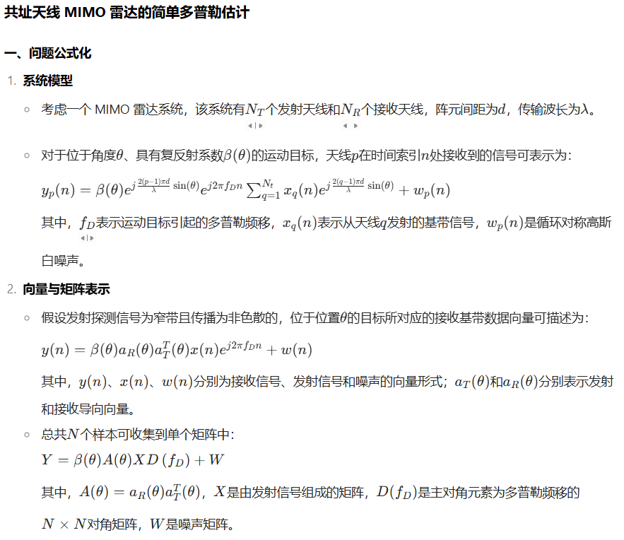
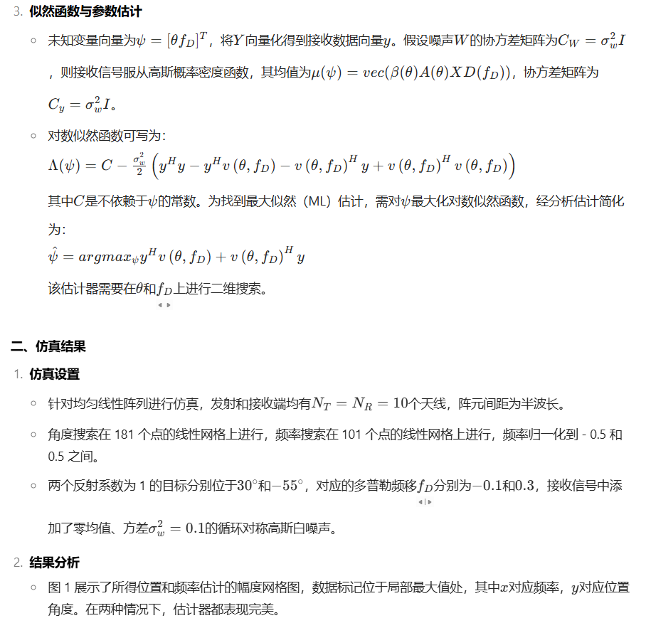
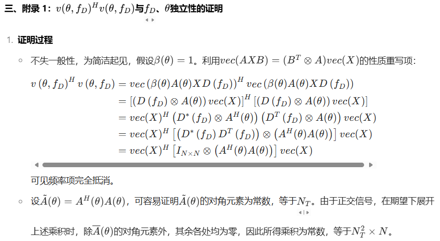
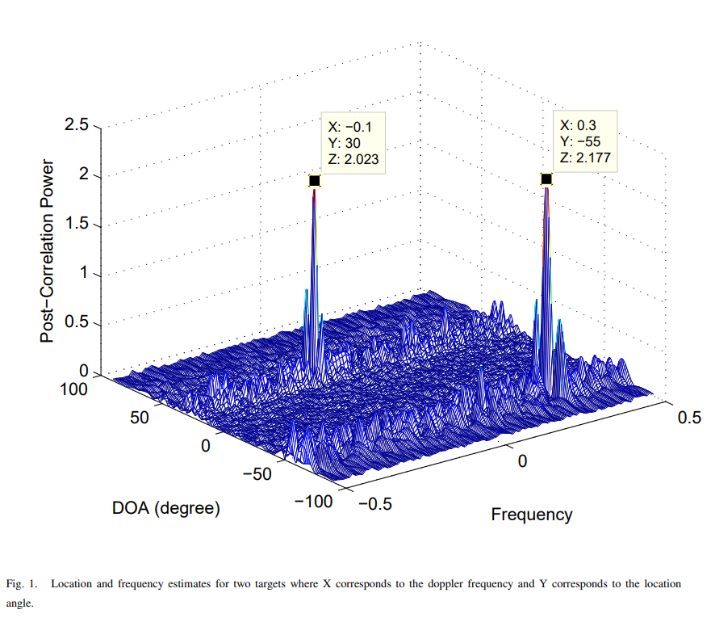

# [Modulation Identification] FCOS: A Two-Stage Recoverable Model Pruning Framework for Automated Modulation Identification [with Python Code]

MATLAB code
clearnT = 10;nR = 10;L = 181;M = 101;theta = linspace(-90,90,L).'*pi/180;freq = linspace(-0.5,0.5,M).';% Transmitted SignalN = 100;X = (sign(randn(nT,N)) + 1j*sign(randn(nT,N)))/sqrt(2);% for n = 1:N%     X(:,n) = R^(0.5)*X(:,n);% end% X = (sign(randn(1,N)) + 1j*sign(randn(1,N)))/sqrt(2);% X = repmat(X,nT,1);% SNR_range = -80:5:-10;% rr = length(SNR_range);% for r = 1:rr%     SNR = 10^(SNR_range(r)/10);%     varn = 1/SNR;varn = 1;% Target 1fd = -0.1;thetat = -55*pi/180;d = exp(1j*2*pi*fd*(0:N-1)).';aT = exp(1j*pi*(0:nT-1)*sin(thetat)).';aR = exp(1j*pi*(0:nR-1)*sin(thetat)).';Y = aR*aT.'*X*diag(d);% Target 2fd = 0.3;thetat = -55*pi/180;d = exp(1j*2*pi*fd*(0:N-1)).';aT = exp(1j*pi*(0:nT-1)*sin(thetat)).';aR = exp(1j*pi*(0:nR-1)*sin(thetat)).';Y = Y + aR*aT.'*X*diag(d);% Target 3fd = -0.2;thetat = 0*pi/180;d = exp(1j*2*pi*fd*(0:N-1)).';aT = exp(1j*pi*(0:nT-1)*sin(thetat)).';aR = exp(1j*pi*(0:nR-1)*sin(thetat)).';Y = Y + aR*aT.'*X*diag(d);% NoiseY = Y + sqrt(varn)*(randn(nR,N) + 1j*randn(nR,N));y = vec(Y);% DetectionP = zeros(L,M);for i = 1:L    aT = exp(1j*pi*(0:nT-1)*sin(theta(i))).';    aR = exp(1j*pi*(0:nR-1)*sin(theta(i))).';    A = aR*aT.';    for k = 1:M        dk = exp(1j*2*pi*freq(k)*(0:N-1)).';        vk = vec(A*X*diag(dk));        P(i,k) = abs(y'*vk + vk'*y) / (2*N*nT*nR);    endendmesh(freq,theta*180/pi,P)xlabel('Frequency')ylabel('DOA (degree)')zlabel('Post-Correlation Power')%% MSE% % [val,t_ind] = max(max(P'));% [val,f_ind] = max(max(P));% % t_mse(r) = (thetat-theta(t_ind))^2;% f_mse(r) = (fd - freq(f_ind))^2;% % end% % plot(SNR_range,t_mse)% plot(SNR_range,f_mse)\n  
End

## Images

<!-- PAYMENT_BLOCK -->

## Get this dataset

- Payment link (Stripe): [Buy now](https://buy.stripe.com/3cs8yP7sY87d0vu9AB)
- Payment QR code: 

<!-- /PAYMENT_BLOCK -->
